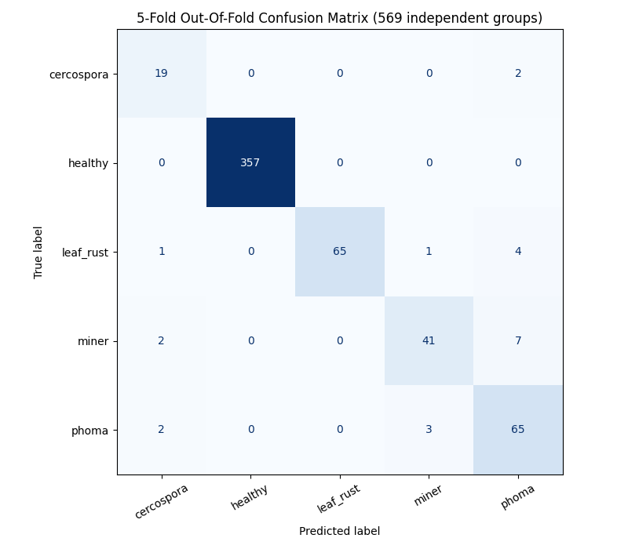

# Phân loại bệnh lá cà phê với MobileNetV3Large

Đồ án CS114 xây dựng mô hình phân loại ảnh lá cà phê thành năm nhãn gồm đốm lá Cercospora, lá khỏe, gỉ sắt lá, sâu đục lá và đốm lá Phoma. Bài làm dùng MobileNetV3Large khởi tạo từ trọng số ImageNet và đánh giá bằng kiểm định chéo 5 fold theo nhóm ảnh.

Trên 569 nhóm, mô hình đạt **Accuracy 96,13% và Macro-F1 90,84%** theo dự đoán out-of-fold (OOF). Trên riêng 212 nhóm ảnh bệnh từ JMuBEN, hai chỉ số lần lượt là **89,62% và 88,55%**. [Notebook](kaggle/mobilenetv3large_jmuben.ipynb) · [Phiên chạy Kaggle](https://www.kaggle.com/code/ngtunthanh/mobilenetv3large-jmuben) · [Báo cáo kết quả](results/RESULTS.md)

## 1. Dữ liệu

Bản dữ liệu trên Kaggle gộp JMuBEN và JMuBEN2 thành một bộ 58.549 ảnh. Notebook dùng bốn lớp bệnh từ bộ này. Kiểm tra ảnh `Healthy` cho thấy nhiều biến thể được tạo từ rất ít lá gốc, nên bài làm dùng 791 ảnh `coffee___healthy` của RoCoLe để có đủ nhóm lá khỏe cho các fold. RoCoLe là ảnh cà phê Robusta chụp ngoài thực địa, còn JMuBEN là ảnh cà phê Arabica với cách chụp và xử lý khác. Sự khác biệt về nguồn là một giới hạn của phép đánh giá năm lớp. [Bài báo JMuBEN và JMuBEN2](https://pmc.ncbi.nlm.nih.gov/articles/PMC8165403/) · [JMuBEN trên Kaggle](https://www.kaggle.com/datasets/noamaanabdulazeem/jmuben-coffee-dataset) · [RoCoLe trên Kaggle](https://www.kaggle.com/datasets/nirmalsankalana/rocole-a-robusta-coffee-leaf-images-dataset)

| Nhãn trong notebook | Nguồn sử dụng | Ảnh đưa vào lọc trùng | Ảnh giữ lại | Nhóm đánh giá |
|---|---|---:|---:|---:|
| `cercospora` | JMuBEN | 7.681 | 89 | 21 |
| `healthy` | RoCoLe | 791 | 759 | 357 |
| `leaf_rust` | JMuBEN | 8.336 | 611 | 71 |
| `miner` | JMuBEN2 | 16.978 | 451 | 50 |
| `phoma` | JMuBEN | 6.571 | 196 | 70 |
| **Tổng** | | **40.357** | **2.106** | **569** |

Notebook đọc và kiểm tra cả 59.340 ảnh đầu vào trước khi loại 18.983 ảnh Healthy của JMuBEN. Không phát hiện ảnh lỗi khi giải mã. Cột **Nhóm đánh giá** đếm các cụm ảnh sau khi gộp. Tên nhãn được chuẩn hóa, gồm đổi tên thư mục `Cerscospora` thành nhãn `cercospora`. [Kiểm toán dữ liệu](results/data_audit.json) · [Ảnh mẫu](results/raw_samples.png) · [Phân bố dữ liệu thô](results/raw_eda.png)

## 2. Lọc ảnh trùng và chia fold

Chia ngẫu nhiên từng ảnh có thể đưa các biến thể của cùng một lá vào cả tập huấn luyện lẫn tập kiểm thử. Pipeline giữ các ảnh có liên hệ trong cùng một nhóm trước khi chia.

1. **Tìm ảnh trùng và gần trùng bằng pHash.** Tính pHash 64 bit dựa trên DCT ở tám hướng xoay và lật. Nối các ảnh có khoảng cách Hamming không quá 4 và giữ một ảnh cho mỗi giá trị hash chuẩn hóa trùng nhau.
2. **Gộp các liên kết theo nguồn.** Với JMuBEN, trích embedding từ MobileNetV3Large đóng băng, lấy trung bình đặc trưng ở tám hướng và nối các ảnh giữ lại có cosine từ 0,85 trở lên. Với RoCoLe, nối các ảnh cùng mã lá dạng `C<x>P<y>`, gồm cả liên kết tìm được từ những ảnh bị loại do trùng hash. Sau đó lấy các thành phần liên thông làm nhóm. Pipeline loại nhóm xung đột nhãn nếu có. Lần chạy báo cáo có 0 nhóm xung đột.
3. **Chia 5 fold theo nhóm.** Dùng `StratifiedGroupKFold` với seed 42. Lượt `k` dùng fold `k` để test, fold `(k + 1) % 5` để validation và ba fold còn lại để train. Train dùng toàn bộ ảnh giữ lại của các nhóm huấn luyện. Validation và test dùng một ảnh đại diện cho mỗi nhóm để nhóm có nhiều ảnh không được tính nhiều lần.
4. **Kiểm tra sau khi chia.** Notebook xác nhận mỗi fold có đủ năm lớp. Các nhóm, hash và mã lá RoCoLe được kiểm tra để tránh giao nhau giữa các fold. Trên toàn bộ manifest, 0 trong 384 mã lá RoCoLe xuất hiện ở nhiều fold. Cosine lớn nhất giữa các ảnh JMuBEN giữ lại thuộc hai fold khác nhau là 0,84992, dưới ngưỡng gộp 0,85.

[Manifest phân nhóm](results/group_audit.csv) · [Manifest chia fold](results/split_manifest.csv) · [Các cặp JMuBEN gần nhất giữa tập train và test của fold 0](results/cross_split_nearest_pairs.png)

## 3. Huấn luyện

MobileNetV3Large dùng trọng số `IMAGENET1K_V2` và thay lớp đầu ra bằng lớp tuyến tính có năm đầu ra. Mỗi lượt huấn luyện khởi tạo lại từ cùng trọng số ImageNet.

| Thành phần | Thiết lập |
|---|---|
| Ảnh đầu vào | RGB, chỉnh hướng EXIF và chuẩn hóa theo ImageNet |
| Tăng cường trên tập train | Cắt ngẫu nhiên 224 × 224, lật ngang/dọc, xoay tối đa 20°, ColorJitter và RandomErasing với xác suất 0,15 |
| Tiền xử lý validation/test | Resize cạnh ngắn về 232 pixel, crop giữa 224 × 224 |
| Warm-up | Đóng băng khối trích đặc trưng trong 3 epoch đầu, learning rate `1e-3` |
| Fine-tune | Mở khối trích đặc trưng, learning rate `1e-4` với cosine annealing có mức sàn `1e-6` |
| Tối ưu | AdamW, weight decay `1e-3`, batch size 64, mixed precision |
| Hàm mất mát | Cross-entropy có trọng số nghịch tần suất lớp trong tập train, label smoothing 0,05 khi huấn luyện |
| Chọn checkpoint | Validation Macro-F1 cao nhất, tối đa 25 epoch, early stopping với patience 6 trong giai đoạn fine-tune |

Tổng thời gian huấn luyện và đánh giá các fold theo bộ đếm trong notebook là 15,09 phút trên Tesla T4. Thời gian đọc ảnh, lọc trùng và trích embedding được thực hiện trước phần đo này. [Cấu hình và môi trường](results/environment.json) · [Lịch sử từng epoch](results/history.csv)

## 4. Kết quả và phân tích lỗi

OOF gộp dự đoán test từ cả năm fold, mỗi nhóm đóng góp đúng một dự đoán. Cột trung bình ± độ lệch chuẩn cho biết kết quả thay đổi thế nào giữa các fold. Macro-F1 cho mỗi lớp trọng số bằng nhau, hữu ích khi lớp Healthy chiếm 357/569 nhóm.

| Chỉ số | Trung bình ± độ lệch chuẩn qua 5 fold | OOF |
|---|---:|---:|
| Accuracy (5 lớp) | 96,16% ± 0,83 điểm % | 96,13% |
| Macro-F1 (5 lớp) | 91,24% ± 1,74 điểm % | 90,84% |
| Weighted-F1 (5 lớp) | 96,21% ± 0,85 điểm % | 96,18% |
| Accuracy trên ảnh bệnh JMuBEN | 89,68% ± 2,12 điểm % | 89,62% |
| Macro-F1 trên ảnh bệnh JMuBEN | 89,05% ± 2,17 điểm % | 88,55% |

Hai dòng cuối lọc các ảnh bệnh trong dự đoán của cùng mô hình năm lớp. Chúng giúp đọc hiệu năng trên dữ liệu JMuBEN mà không tính các nhóm lá khỏe RoCoLe vào điểm tổng hợp. [Chỉ số từng fold](results/cv_fold_results.csv) · [Dự đoán OOF](results/test_predictions.csv)

| Lớp | Precision | Recall | F1 | Số nhóm |
|---|---:|---:|---:|---:|
| `cercospora` | 79,17% | 90,48% | 84,44% | 21 |
| `healthy` | 100,00% | 100,00% | 100,00% | 357 |
| `leaf_rust` | 100,00% | 91,55% | 95,59% | 71 |
| `miner` | 91,11% | 82,00% | 86,32% | 50 |
| `phoma` | 83,33% | 92,86% | 87,84% | 70 |

Mô hình nhầm nhiều nhất từ `miner` sang `phoma` với 7/50 nhóm Miner. `cercospora` có F1 thấp nhất và chỉ có 21 nhóm, nên vài dự đoán sai có thể làm điểm của lớp này dao động đáng kể. [Báo cáo theo lớp](results/classification_report.csv) · [Ví dụ dự đoán sai](results/misclassified.png)



Biểu đồ huấn luyện hiển thị từng fold và đường trung bình tại các epoch mà cả năm fold đã hoàn tất. Grad-CAM minh họa vùng ảnh ảnh hưởng đến điểm của lớp được dự đoán trên một số ảnh test ở fold 0. [Đường học](results/learning_curves.png) · [Grad-CAM](results/gradcam.png)

## 5. Chạy lại trên Kaggle

1. Mở [notebook](kaggle/mobilenetv3large_jmuben.ipynb) trong Kaggle, chọn GPU T4 và tắt Internet.
2. Gắn ba nguồn dữ liệu trong [kernel-metadata.json](kaggle/kernel-metadata.json) gồm JMuBEN, RoCoLe và bộ trọng số MobileNetV3Large ImageNet. Notebook kiểm tra checksum của trọng số trước khi dùng.
3. Chọn **Run All** hoặc **Save Version → Save & Run All**. Kết quả ghi vào `/kaggle/working/results/`. File `SUCCESS.json` được ghi sau khi pipeline kết thúc.

Nếu tài khoản có quyền cập nhật notebook được cấu hình trong metadata, có thể chạy bằng Kaggle CLI từ thư mục gốc của repo.

```powershell
python -m kaggle kernels push -p kaggle --accelerator NvidiaTeslaT4 -t 14400
```

Trong [output Kaggle](https://www.kaggle.com/code/ngtunthanh/mobilenetv3large-jmuben/output) có `results/best.pt` và `results/deploy/mobilenetv3large.ts` của fold 0. TorchScript nhận tensor RGB đã tiền xử lý có kích thước `N × 3 × 224 × 224` và trả về logits cho năm lớp. Checkpoint PyTorch và TorchScript cho đầu ra khớp trong phép thử CPU trên một ảnh test của fold 0. [Thứ tự lớp và chuẩn hóa](results/deploy/metadata.json) · [Kết quả kiểm tra suy luận](results/deploy/inference_check.json)

## 6. Giới hạn

- **Nguồn ảnh gắn với nhãn.** Toàn bộ ảnh khỏe đến từ RoCoLe và toàn bộ ảnh bệnh đến từ JMuBEN. Điểm Healthy hoàn hảo trên phép chia này có thể phản ánh cả sự khác biệt giữa hai bộ dữ liệu.
- **Nhóm JMuBEN được suy ra từ ảnh.** Một số cặp ở hai fold vẫn trông rất giống nhau dưới ngưỡng cosine. Tài liệu mô tả cách tăng cường ảnh nhưng thiếu ánh xạ từ từng biến thể về lá gốc, nên phép chia chưa xác nhận được tính độc lập ở cấp lá cho JMuBEN.
- **Phạm vi kiểm thử.** Bài làm đánh giá trên dữ liệu hiện có và kiểm tra bản xuất fold 0 trên CPU. Hiệu năng trên ảnh từ vườn khác và độ trễ trên thiết bị di động chưa được đo.
